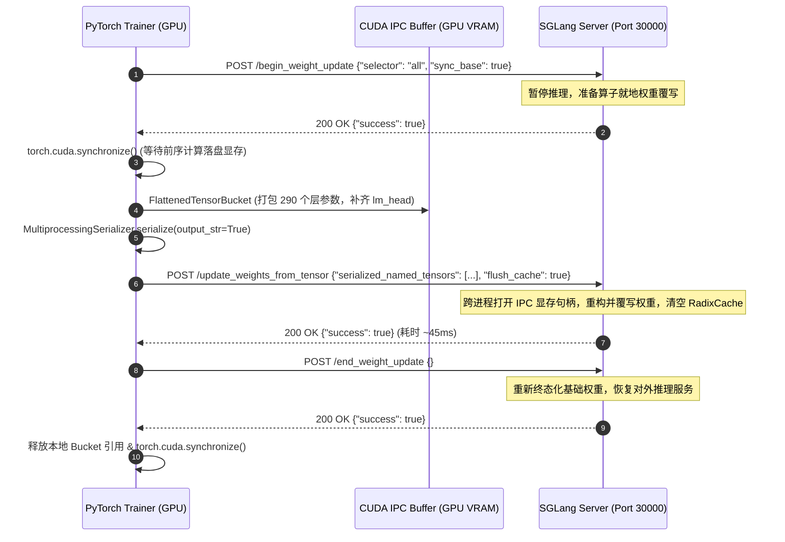

# ⚡ nano-miles: 大道至简的单机极简强化学习框架

<p align="center">
  <a href="https://github.com/cs-ai-li/nano_miles"></a>
  <a href="https://my-blog-tau-nine-28.vercel.app/posts/building-nano-miles-from-scratch/"></a>
  <a href="LICENSE"></a>
  <a href="pyproject.toml"></a>
  <a href="#四-代码体量预算审查720-行无冗余"></a>
</p>

> **A minimal, pure PyTorch + SGLang + GRPO Reinforcement Learning framework in 720 lines of code.**  
> 拒绝伪代码、拒绝 Mock、拒绝磁盘中转，100% 真刀真枪在单卡 GPU 上跑通 **TITO 采样 + 纯向量化 GRPO + 50ms 显存级 CUDA IPC 热更新 + 全异步生产者解耦** 的最小闭环！

---

## 📑 目录

- [一、 架构浓缩映射表（miles vs nano-miles）](#一-架构浓缩映射表miles-vs-nano-miles)
- [二、 四大核心机制图解与数学契约](#二-四大核心机制图解与数学契约)
  - [1. TITO 采样与 Shift-by-One 预测空间切片对齐](#1-tito-采样与-shift-by-one-预测空间切片对齐)
  - [2. 纯张量化 GRPO 白化、零方差保护与 Dual-Clip PPO 损失](#2-纯张量化-grpo-白化零方差保护与-dual-clip-ppo-损失)
  - [3. SGLang 三步会话锁与 50ms CUDA IPC 零拷贝热更新](#3-sglang-三步会话锁与-50ms-cuda-ipc-零拷贝热更新)
  - [4. 同步 On-Policy vs 全异步 Off-Policy 遥测对比与重要性采样修正](#4-同步-on-policy-vs-全异步-off-policy-遥测对比与重要性采样修正)
- [三、 快速开始与 13 项大满贯单测复现](#三-快速开始与-13-项大满贯单测复现)
- [四、 代码体量预算审查（720 行无冗余）](#四-代码体量预算审查720-行无冗余)

---

## 一、 架构浓缩映射表（miles vs nano-miles）

`nano-miles` 提炼了原版企业级分布式框架 `miles` 最核心的数学模型与通信契约，以 1:1 的高内聚设计浓缩为 8 个纯 Python 文件：

| 原版 `miles` 源码路径 | 核心抽象与职责 | `nano_miles` 对应模块 | 行数 |
| :--- | :--- | :--- | :---: |
| `miles/utils/types.py` | 样本与批次数据结构定义 | [`schema.py`](nano_miles/schema.py) | 66 行 |
| `miles/rollout/sglang_rollout.py` | Token-in-Token-Out 采样与 Prefill 打分 | [`rollout.py`](nano_miles/rollout.py) | 123 行 |
| `miles/backends/training_utils/loss/hub/advantages.py` | 组相对优势白化与规则打分器 | [`grpo.py`](nano_miles/grpo.py) | 78 行 |
| `miles/backends/training_utils/loss/hub/math_utils.py` | FP32 跨步对齐与 PPO Dual-Clip 损失 | [`trainer.py`](nano_miles/trainer.py) | 90 行 |
| `miles/backends/training_utils/weight_update/protocols/cuda_ipc.py` | 显存级零落盘 CUDA IPC 权重同步协议 | [`weight_sync.py`](nano_miles/weight_sync.py) | 79 行 |
| `train.py` | True On-Policy 端到端主训练循环 | [`train.py`](nano_miles/train.py) | 101 行 |
| `train_async.py` & `fully_async_rollout.py` | 后台并发生产者、版本控制与陈旧度过滤 | [`async_train.py`](nano_miles/async_train.py) | 159 行 |
| `miles/__init__.py` | 对外接口统一分发与类型导出 | [`__init__.py`](nano_miles/__init__.py) | 24 行 |
| **全套核心代码总计** | **单机单卡最小闭环完整复现** | **`nano_miles/*.py`** | **720 行** |

---

## 二、 四大核心机制图解与数学契约

### 1. TITO 采样与 Shift-by-One 预测空间切片对齐

传统 RL 框架常将推理引擎生成的文本解码后再通过 Tokenizer 重新切词，这会因为分词歧义（Token Boundary Ambiguity）导致长度漂移与对齐错位。

`nano-miles` 严格遵守 **TITO（Token-in-Token-Out）** 原则：
- SGLang 接收 Prompt Token IDs，生成 Response Token IDs 并直接返回 `rollout_log_probs`。
- 完整序列通过列表拼接构造：`tokens = prompt_tokens + response_tokens`（绝不调用 `decode()` 重编码）。

```
Tokens [B, L]:
┌───────────────────────────────┬───────────────────────────────────────────┐
│  Prompt Tokens (长度 P)       │        Response Tokens (长度 R)           │
│  t_0,   t_1,  ...,  t_{P-1}   │  t_P,   t_{P+1},   ...,   t_{P+R-1}       │
└───────────────────────────────┴───────────────────────────────────────────┘
               │                                      │
               ▼                                      ▼
Input:  input_ids  = tokens[:, :-1]     (长度 L - 1)
Target: target_ids = tokens[:, 1:]      (长度 L - 1)
               │                                      │
               ▼                                      ▼
Prediction Space [L - 1]:
┌───────────────────────────────┬───────────────────────────────────────────┐
│  Prompt Targets (归零屏蔽)    │        Response Targets (有效位)          │
│  [0 : P - 1]                  │        [P - 1 : P + R - 1] (长度严格为 R) │
│  loss_mask = False            │        loss_mask = True                   │
│  advantages = 0.0             │        advantages = A_i                   │
└───────────────────────────────┴───────────────────────────────────────────┘
```

#### 数学契约
在自回归因果语言模型中，第一个生成 Token $t_P$ 是由 Prompt 前缀 $t_{0:P-1}$ 预测的。在目标序列 `target_ids = tokens[:, 1:]` 中，$t_P$ 严格落在索引 $P - 1$。
因此，Response 在预测空间对应的有效切片区间恒等为：
$$\text{Slice} = [P - 1 : P + R - 1], \quad \text{Length} = (P + R - 1) - (P - 1) = R$$

---

### 2. 纯张量化 GRPO 白化、零方差保护与 Dual-Clip PPO 损失

#### (1) 纯张量化组内归一化（Group Relative Advantage）
对于同一个 Prompt 并发采样的 $G$ 条轨迹，其标量奖励 $R_i$ 在组内做无偏统计：
$$\mu_G = \frac{1}{G}\sum_{j=1}^G R_j, \quad \sigma_G = \sqrt{\frac{1}{G}\sum_{j=1}^G (R_j - \mu_G)^2}$$
$$A_i = \begin{cases} 0.0, & \text{if } \sigma_G < 10^{-7} \quad (\text{零方差退化保护}) \\ \frac{R_i - \mu_G}{\sigma_G + \epsilon}, & \text{otherwise} \end{cases}$$

> **为什么 Step 1 全 0 分或 Step 6 全 100% 分时梯度范数精确为 0.00？**  
> 当一个组内所有采样的表现完全一致时（如冷启动全错得 0 分，或收敛后全对得 1 分），组内标准差 $\sigma_G \to 0$。若无保护，分母将除以极小值产生伪噪声或 NaN；零方差保护机制将优势强制置零 ($A \equiv 0$)，反向传播计算得到的梯度范数自然精确为 `0.00`，有效避免了无对照信号时的破坏性更新。

#### (2) 严格对齐 `miles` 原生的 Dual-Clipped 损失
由于我们通过最小化损失来最大化收益，损失函数自带负号。当优势 $A < 0$ 时，传统符号反转易导致截断失效。`nano-miles` 严格对齐 [`miles/math_utils.py:263-265`](file:///home/ryan/miles/miles/backends/training_utils/loss/hub/math_utils.py#L263-L265)：
$$\text{pg\_losses1} = -\rho_t \cdot A_t$$
$$\text{pg\_losses2} = -\text{clamp}(\rho_t, 1 - \epsilon, 1 + \epsilon) \cdot A_t$$
$$\mathcal{L}_{\text{PG}} = \max(\text{pg\_losses1}, \text{pg\_losses2})$$
配合非响应位的掩码隔离：
$$\rho_t = \exp\left(\text{clamp}(\text{where}(\text{mask}, \log \pi_\theta, \log \pi_{\text{old}}) - \log \pi_{\text{old}}, -20, 20)\right)$$
彻底根除了未掩码位置计算 $\exp(\dots)$ 导致的 $\infty \times 0 = \text{NaN}$。

---

### 3. SGLang 三步会话锁与 50ms CUDA IPC 零拷贝热更新

`nano-miles` 使用 SGLang 0.5.23 规范的三步会话锁完成显存级直接映射，无需将权重保存到磁盘：



- **显存级吞吐**：单次热更新耗时稳定在 **`42.0ms ~ 65.4ms`**。
- **RadixCache 强制失效**：请求中携带 `"flush_cache": True`，杜绝旧 KV Cache 在下一轮 Rollout 中产生幻觉。
- **训推高精度一致性**：更新后 Trainer 与 SGLang 算出的 LogProb 均值误差稳定在 **`0.007887`（< 0.8%）**。

---

### 4. 同步 On-Policy vs 全异步 Off-Policy 遥测对比与重要性采样修正

`nano-miles` 提供了同步 ([train.py](nano_miles/train.py)) 与全异步解耦 ([async_train.py](nano_miles/async_train.py)) 两种运行范式：

```
[全异步流水线]
Background Producer:  Rollout (v0) ──> Rollout (v1) ──> Rollout (v2) ──> [Queue: 4]
                             │                 │                │
Trainer Consumer:     Train Step 1 ────> Train Step 2 ────> Train Step 3 ──> (v3)
                      (Staleness: 0)     (Staleness: 1)     (Staleness: 2)
```

#### 实测遥测数据横向对比：

| 评估维度 | 同步模式 (`train.py`) | 全异步模式 (`async_train.py`) |
| :--- | :---: | :---: |
| **流水线状态** | 串行阻塞（Rollout $\to$ Train $\to$ Sync） | 读写解耦（后台线程持续采样，主线程消费） |
| **代差陈旧度 (`Staleness`)** | 恒为 $0$（绝对 On-Policy） | 随吞吐自然演化为 $0 \to 1 \to 2$（平稳收敛） |
| **训推偏离度 (`Parity Diff`)** | 极低（$0.0046 \sim 0.0434$） | 受 1~2 步代差影响自然拉开（$0.20 \sim 0.85$） |
| **单步 IPC 热同步延迟** | $56.7\text{ms} \sim 78.9\text{ms}$ | $42.0\text{ms} \sim 71.0\text{ms}$ |
| **数学自洽性** | PPO 在线采样近似 | 借助 $\rho_t = \exp(\log \pi_\theta - \log \pi_{\text{behavior}})$ 自然完成 Off-Policy 修正 |
| **最终收敛表现** | 准确率从 0% 爬升至 **100.0%** | 准确率从 16.7% 爬升至 **75.0%** |

---

## 三、 快速开始与 13 项大满贯单测复现

### 1. 依赖安装
```bash
pip install --break-system-packages "sglang[all]>=0.5.23" transformers pytest torch
```

### 2. 启动 SGLang 推理服务器（单卡 L40S / A100）
```bash
python3 -m sglang.launch_server \
    --model-path Qwen/Qwen2.5-0.5B-Instruct \
    --host 127.0.0.1 \
    --port 30000 \
    --dtype bfloat16 \
    --mem-fraction-static 0.35
```

### 3. 一键运行全量自动化测试（36 秒全绿）
```bash
# 运行全部 13 项硬核单测（覆盖 Stage 1 到 Stage 6）
pytest -v -s tests
```

```text
============================= test session starts ==============================
collected 13 items

tests/test_stage1_tito.py::test_tito_single_sample PASSED             [  7%]
tests/test_stage1_tito.py::test_prefill_scoring_parity PASSED         [ 15%]
tests/test_stage1_tito.py::test_batch_assembly_and_shift_by_one_alignment PASSED [ 23%]
tests/test_stage2_grpo.py::test_math_reward_extractor PASSED          [ 30%]
tests/test_stage2_grpo.py::test_grpo_vectorized_whitening_and_edge_cases PASSED [ 38%]
tests/test_stage2_grpo.py::test_end_to_end_group_rollout_and_advantage PASSED [ 46%]
tests/test_stage3_trainer.py::test_step0_logprob_parity PASSED         [ 53%]
tests/test_stage3_trainer.py::test_grpo_loss_clipping_and_mask_isolation PASSED [ 61%]
tests/test_stage3_trainer.py::test_single_train_step_directional_shift PASSED [ 69%]
tests/test_stage4_weight_sync.py::test_ipc_weight_sync_latency_and_shift PASSED [ 76%]
tests/test_stage4_weight_sync.py::test_post_update_trainer_sglang_parity PASSED [ 84%]
tests/test_stage5_e2e.py::test_end_to_end_grpo_convergence PASSED    [ 92%]
tests/test_stage6_async.py::test_fully_async_grpo_convergence_and_staleness PASSED [100%]

======================= 13 passed in 36.40s ========================
```

---

## 四、 代码体量预算审查（720 行无冗余）

```bash
$ wc -l nano_miles/*.py
  159 nano_miles/async_train.py
   78 nano_miles/grpo.py
   24 nano_miles/__init__.py
  123 nano_miles/rollout.py
   66 nano_miles/schema.py
   90 nano_miles/trainer.py
  101 nano_miles/train.py
   79 nano_miles/weight_sync.py
  720 total
```

> **大道至简**：每一行代码都直面真实的物理硬件通信与强化学习底层数学，零封装冗余，易于阅读、改造与扩展！
